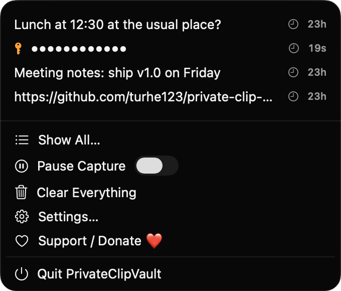
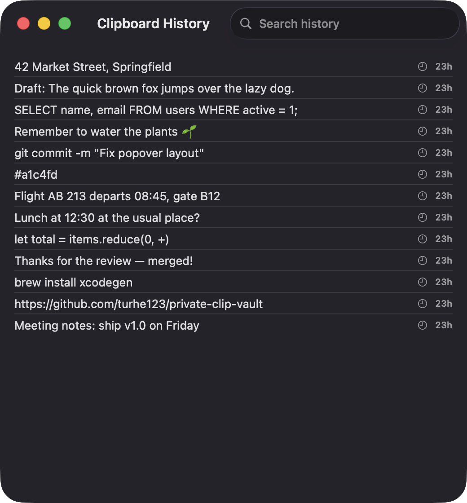
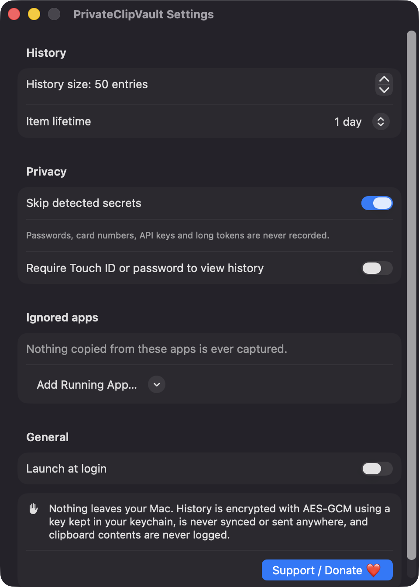

# PrivateClipVault

**🌐 Website:** [turhe123.github.io/private-clip-vault](https://turhe123.github.io/private-clip-vault/)

A clipboard history that skips secrets, expires old items, and keeps everything encrypted on your Mac.


## Why

PrivateClipVault is a free, open-source, 100% native, backend-free alternative to paid utilities in the *Clipboard* category. It was inspired by the simple, dependable menu bar history of CopyClip 2 ($7.99 one-time), and takes that idea in a privacy-first direction: sensitive items are filtered, history expires on its own, and storage is encrypted. There is no server, no account, no analytics, and no network code.

## Features

- **Menu bar clipboard history** for text copied from any app. Default size is 50 entries (adjustable from 10 to 500). The menu shows the 10 most recent.
- **Secret detection** that skips (or keeps only briefly) probable secrets:
  - items marked concealed by password managers (`org.nspasteboard.ConcealedType`); transient and auto-generated pasteboard items are always ignored
  - card numbers (13–19 digits) that pass a Luhn check
  - well-known key prefixes (`sk-`, `ghp_`, `github_pat_`, `AKIA`, `xoxb-`, `-----BEGIN`, JWT headers, and more)
  - long, high-entropy tokens of 32+ characters with no whitespace (URLs and paths are excluded)
- **Auto-expiry**: global lifetime of 1 minute, 5 minutes, 1 hour, 1 day, or never. If you turn off "Skip detected secrets", detected secrets are kept for only 30 seconds and shown as dots.
- **Encrypted at rest**: history is serialized and sealed with AES-GCM (CryptoKit). The 256-bit key is stored in your login keychain, and the sealed file lives in `~/Library/Application Support/PrivateClipVault/vault.sealed`. Expired items are removed from disk on the next write (purge runs every 15 seconds).
- **Optional lock**: require Touch ID or your account password (LocalAuthentication) to view history. It re-locks after 60 seconds of inactivity and when the screen locks, and decrypted history is dropped from memory.
- **Ignored apps**: nothing copied from apps you choose is ever captured.
- **Pause Capture** switch and **Clear Everything** command.
- **Show All window** with a searchable list.
- **Click an entry to copy it back.** Entries restored from a sensitive item are marked concealed again.
- **Launch at login** via `SMAppService`.
- **Entry size cap** of 100 KB, and clipboard contents are never logged.
- **Recovery**: if the keychain key is missing or the vault can't be decrypted, the app offers to reset the vault instead of crashing.

## Screenshots

<p align="center"></p>

<p align="center"><em>The menu bar popover lists your recent clips, with a detected API key masked as dots and set to expire in seconds.</em></p>

<p align="center"></p>

<p align="center"><em>The Clipboard History window shows your full history in a searchable list click any entry to copy it back.</em></p>

<p align="center"></p>

<p align="center"><em>In Settings you choose history size, item lifetime, secret skipping, the Touch ID lock, ignored apps and launch at login.</em></p>

## Install

1. Download `PrivateClipVault-macOS.zip` from the [latest release](https://github.com/turhe123/private-clip-vault/releases/latest).
2. Unzip it and move `PrivateClipVault.app` to `/Applications`.
3. Because the app is open source and not notarized, clear the quarantine flag:

   ```bash
   xattr -cr /Applications/PrivateClipVault.app
   ```

4. Right-click the app → **Open** the first time.

PrivateClipVault runs as a menu bar app (no Dock icon). Requires macOS 14.0 or later.

## Build from source

Requires Xcode with Swift 5.9+ and [XcodeGen](https://github.com/yonaskolb/XcodeGen).

```bash
brew install xcodegen
xcodegen generate
xcodebuild -project PrivateClipVault.xcodeproj -scheme PrivateClipVault -configuration Release -derivedDataPath ./build build
```

The app is produced at `build/Build/Products/Release/PrivateClipVault.app`.

## Permissions

PrivateClipVault requests **no** special privacy permissions. In particular it does not need, and does not ask for, Accessibility, Screen Recording, or Microphone access. It reads the clipboard by polling `NSPasteboard`, which requires no permission. What it does use:

- **Keychain access** (its own item only): stores the vault encryption key.
- **Touch ID / account password** (only if you enable the lock): to unlock history.
- **Login Items** (only if you enable Launch at login): macOS may ask you to approve it in System Settings › General › Login Items.
- **Frontmost app name**: read via `NSWorkspace` at copy time, to label entries and apply the ignored-apps list.

Nothing leaves your Mac.

## Support ❤️

PrivateClipVault is free and always will be. If it's useful to you, you can support its development:

[Support Or (Leo) Davidai ❤️](https://ko-fi.com/leodavidai)

## License

MIT © Or Davidai Bachar
